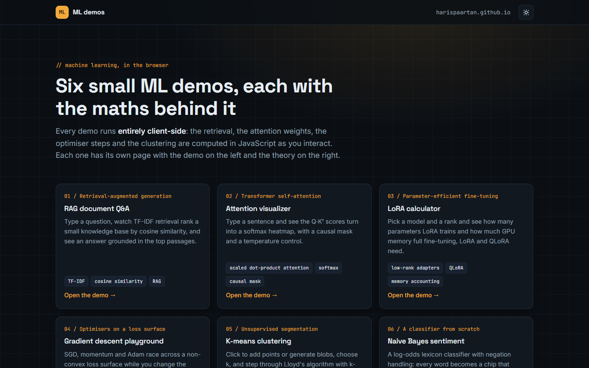
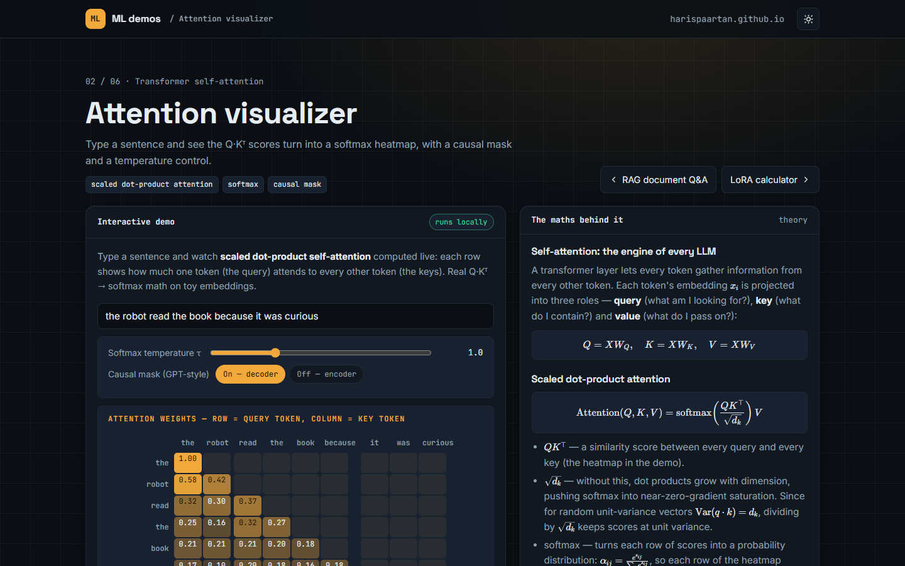

# ML demos in the browser

Six small machine-learning demos that run entirely client-side, each on its own page with the interactive part next to the maths behind it. No server, no framework, no tracking, no request leaves the page.

Live: https://harispaartan.github.io/ml-demos/ · part of https://harispaartan.github.io/



| Page | What it shows | Maths in the theory column |
|---|---|---|
| [RAG document Q&A](https://harispaartan.github.io/ml-demos/rag.html) | TF-IDF retrieval over a small knowledge base, then an answer grounded in the top passages | TF-IDF, cosine similarity, RAG marginalisation |
| [Attention visualizer](https://harispaartan.github.io/ml-demos/attention.html) | A live Q·Kᵀ softmax heatmap for a sentence you type, with causal mask and temperature | scaled dot-product attention, softmax, positional encoding |
| [LoRA calculator](https://harispaartan.github.io/ml-demos/lora.html) | Trainable parameters and GPU memory for Llama- and Mistral-class models as you move the rank slider, with a QLoRA toggle | low-rank decomposition ΔW = BA, optimiser memory accounting |
| [Gradient descent playground](https://harispaartan.github.io/ml-demos/gradient.html) | SGD, momentum and Adam racing on a non-convex loss surface with a live learning rate | update rules, bias correction, non-convex optimisation |
| [K-means clustering](https://harispaartan.github.io/ml-demos/kmeans.html) | Click to add points, then step through Lloyd's algorithm with k-means++ initialisation | WCSS objective, convergence, silhouette score |
| [Naive Bayes sentiment](https://harispaartan.github.io/ml-demos/sentiment.html) | A from-scratch classifier with per-word log-odds chips and negation handling | Bayes' theorem, log-odds, Laplace smoothing |



## Run locally

Any static file server works:

```bash
python -m http.server 8000
# open http://localhost:8000
```

## How it is built

- `js/demos/*.js`: one self-contained module per demo. It registers `{ title, theoryHTML, renderDemo(root) }` on `window.DEMOS` and returns a cleanup function; the logic is plain JavaScript (TF-IDF, softmax, optimisers, Lloyd's algorithm, naive Bayes).
- `js/page.js`: mounts the demo named in `<body data-demo>`, fills the theory column, typesets the formulas and handles the theme toggle.
- `css/site.css`: the design tokens, layout and widget styles, shared with the portfolio (dark default, light by toggle).
- `build/build.py`: generates `index.html` and the six demo pages from one template and a manifest. Run `python build/build.py` after editing it.
- `vendor/katex/`: a self-hosted copy of KaTeX 0.19.1 (MIT) for the formulas; `assets/fonts/`: self-hosted Inter, Space Grotesk and JetBrains Mono (SIL OFL).

## Status

Verified on 2026-10-24 with `node tests/smoke.mjs` on Google Chrome: the overview and all six pages render, every demo mounts and every theory column typesets, 0 console errors, no external requests, no horizontal overflow at phone width. The smoke test needs Node, Chrome and a Playwright package that Node can resolve; the site itself has no dependencies.

## Licence

MIT, see `LICENSE`. KaTeX is MIT; the fonts are SIL Open Font License (see `assets/fonts/LICENSES.md`).
